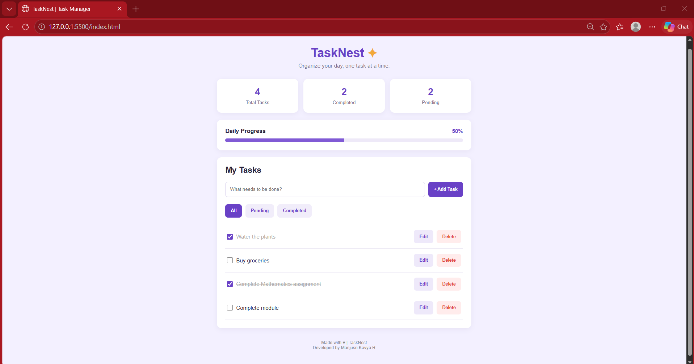
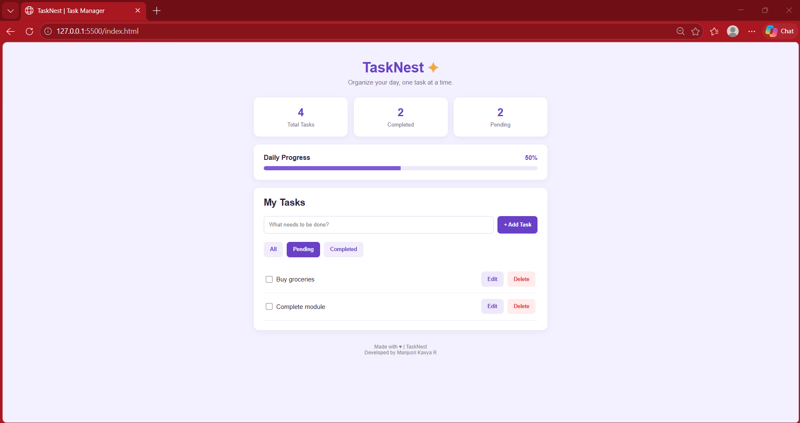
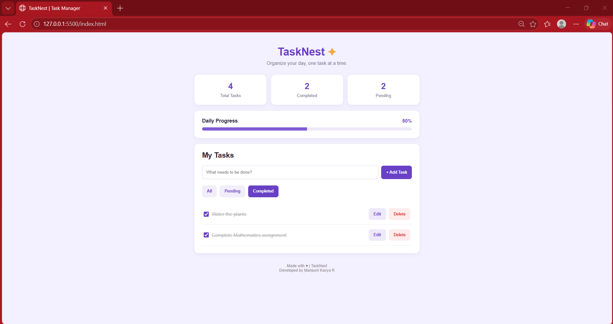

# Ex03 To-Do List using JavaScript
## Date:17/11/2026

## AIM
To create a To-do Application with all features using JavaScript.

## ALGORITHM
### STEP 1
Build the HTML structure (index.html).

### STEP 2
Style the App (style.css).

### STEP 3
Plan the features the To-Do App should have.

### STEP 4
Create a To-do application using Javascript.

### STEP 5
Add functionalities.

### STEP 6
Test the App.

### STEP 7
Open the HTML file in a browser to check layout and functionality.

### STEP 8
Fix styling issues and refine content placement.

### STEP 9
Deploy the website.

### STEP 10
Upload to GitHub Pages for free hosting.

## PROGRAM

### index.html
```

<!DOCTYPE html>
<html lang="en">
<head>
    <meta charset="UTF-8">
    <meta name="viewport" content="width=device-width, initial-scale=1.0">
    <title>TaskNest | Task Manager</title>
    <link rel="stylesheet" href="style.css">
</head>
<body>

    <div class="container">
        <header>
            <h1>TaskNest <span>✦</span></h1>
            <p>Organize your day, one task at a time.</p>
        </header>

        <section class="stats">
            <div class="stat-card">
                <h3 id="total">0</h3>
                <p>Total Tasks</p>
            </div>
            <div class="stat-card">
                <h3 id="completed">0</h3>
                <p>Completed</p>
            </div>
            <div class="stat-card">
                <h3 id="pending">0</h3>
                <p>Pending</p>
            </div>
        </section>

        <section class="progress-section">
            <div class="progress-info">
                <h3>Daily Progress</h3>
                <span id="progress-text">0%</span>
            </div>
            <div class="progress-bar">
                <div id="progress-fill"></div>
            </div>
        </section>

        <section class="task-section">
            <h2>My Tasks</h2>

            <form id="task-form">
                <input type="text" id="task-input"
                    placeholder="What needs to be done?" required>
                <button type="submit">+ Add Task</button>
            </form>

            <div class="filters">
                <button class="filter active" data-filter="all">All</button>
                <button class="filter" data-filter="pending">Pending</button>
                <button class="filter" data-filter="completed">Completed</button>
            </div>

            <ul id="task-list"></ul>
        </section>

        <footer>
            <p>Made with ♥ | TaskNest</p>
            <p>Developed by Manjusri Kavya R</p>
        </footer>
    </div>

    <script src="script.js"></script>
</body>
</html>
```

### style.css
```

* {
    margin: 0;
    padding: 0;
    box-sizing: border-box;
}

body {
    font-family: Arial, sans-serif;
    background: #f3f0ff;
    color: #29243d;
    min-height: 100vh;
    padding: 40px 15px;
}

.container {
    max-width: 750px;
    margin: auto;
}

header {
    text-align: center;
    margin-bottom: 30px;
}

header h1 {
    font-size: 36px;
    color: #6941c6;
}

header h1 span {
    color: #f2a93b;
}

header p {
    color: #77718a;
    margin-top: 8px;
}

.stats {
    display: grid;
    grid-template-columns: repeat(3, 1fr);
    gap: 15px;
    margin-bottom: 20px;
}

.stat-card {
    background: white;
    padding: 22px;
    text-align: center;
    border-radius: 14px;
    box-shadow: 0 4px 15px #30206010;
}

.stat-card h3 {
    color: #6941c6;
    font-size: 28px;
    margin-bottom: 7px;
}

.stat-card p {
    color: #77718a;
    font-size: 14px;
}

.progress-section, .task-section {
    background: white;
    padding: 25px;
    border-radius: 14px;
    margin-bottom: 20px;
    box-shadow: 0 4px 15px #30206010;
}

.progress-info {
    display: flex;
    justify-content: space-between;
    margin-bottom: 12px;
}

.progress-info h3 {
    font-size: 17px;
}

#progress-text {
    color: #6941c6;
    font-weight: bold;
}

.progress-bar {
    height: 10px;
    background: #eee9f8;
    border-radius: 20px;
    overflow: hidden;
}

#progress-fill {
    height: 100%;
    width: 0%;
    background: #805ad5;
    transition: width 0.3s;
}

.task-section h2 {
    margin-bottom: 20px;
}

#task-form {
    display: flex;
    gap: 10px;
}

#task-input {
    flex: 1;
    min-width: 0;
    padding: 13px;
    border: 1px solid #ddd6ee;
    border-radius: 8px;
    outline: none;
    font-size: 14px;
}

#task-input:focus {
    border-color: #805ad5;
}

button {
    cursor: pointer;
    border: none;
    border-radius: 8px;
    padding: 12px 16px;
    font-weight: bold;
}

#task-form button {
    background: #6941c6;
    color: white;
}

#task-form button:hover {
    background: #5130a1;
}

.filters {
    display: flex;
    gap: 10px;
    margin: 22px 0;
}

.filter {
    background: #f1edfa;
    color: #6941c6;
}

.filter.active {
    background: #6941c6;
    color: white;
}

#task-list {
    list-style: none;
}

.task-item {
    display: flex;
    align-items: center;
    gap: 10px;
    padding: 15px 5px;
    border-bottom: 1px solid #eeeaf5;
}

.task-item span {
    flex: 1;
    overflow-wrap: anywhere;
}

.task-item.done span {
    text-decoration: line-through;
    color: #aaa;
}

.task-item input {
    accent-color: #6941c6;
    width: 17px;
    height: 17px;
    cursor: pointer;
}

.edit-btn {
    background: #eee9fa;
    color: #6941c6;
}

.delete-btn {
    background: #ffecec;
    color: #d33;
}

.empty {
    text-align: center;
    color: #999;
    padding: 20px;
}

footer {
    text-align: center;
    color: #888;
    font-size: 13px;
    padding: 15px;
}

@media (max-width: 500px) {
    body {
        padding: 25px 12px;
    }

    .stats {
        gap: 8px;
    }

    .stat-card {
        padding: 15px 5px;
    }

    .stat-card h3 {
        font-size: 23px;
    }

    .stat-card p {
        font-size: 12px;
    }

    .task-section, .progress-section {
        padding: 18px;
    }

    #task-form {
        flex-direction: column;
    }

    .filters {
        gap: 5px;
    }

    .filter {
        padding: 10px;
        font-size: 12px;
    }
}
```

### script.js
```

const form = document.getElementById("task-form");
const input = document.getElementById("task-input");
const taskList = document.getElementById("task-list");

let tasks = JSON.parse(localStorage.getItem("tasks")) || [];
let currentFilter = "all";

function saveTasks() {
    localStorage.setItem("tasks", JSON.stringify(tasks));
}

function renderTasks() {
    taskList.innerHTML = "";

    const filteredTasks = tasks.filter(task => {
        if (currentFilter === "pending") return !task.completed;
        if (currentFilter === "completed") return task.completed;
        return true;
    });

    if (filteredTasks.length === 0) {
        taskList.innerHTML = '<li class="empty">No tasks found. Add a new task!</li>';
    }

    filteredTasks.forEach(task => {
        const li = document.createElement("li");
        li.className = "task-item" + (task.completed ? " done" : "");

        const checkbox = document.createElement("input");
        checkbox.type = "checkbox";
        checkbox.checked = task.completed;

        checkbox.addEventListener("change", () => {
            task.completed = checkbox.checked;
            saveTasks();
            renderTasks();
        });

        const span = document.createElement("span");
        span.textContent = task.text;

        const editButton = document.createElement("button");
        editButton.textContent = "Edit";
        editButton.className = "edit-btn";

        editButton.addEventListener("click", () => {
            const updated = prompt("Edit your task:", task.text);

            if (updated !== null && updated.trim() !== "") {
                task.text = updated.trim();
                saveTasks();
                renderTasks();
            }
        });

        const deleteButton = document.createElement("button");
        deleteButton.textContent = "Delete";
        deleteButton.className = "delete-btn";

        deleteButton.addEventListener("click", () => {
            tasks = tasks.filter(t => t.id !== task.id);
            saveTasks();
            renderTasks();
        });

        li.append(checkbox, span, editButton, deleteButton);
        taskList.appendChild(li);
    });

    updateStats();
}

function updateStats() {
    const total = tasks.length;
    const completed = tasks.filter(task => task.completed).length;
    const pending = total - completed;
    const percentage = total === 0 ? 0 :
        Math.round((completed / total) * 100);

    document.getElementById("total").textContent = total;
    document.getElementById("completed").textContent = completed;
    document.getElementById("pending").textContent = pending;
    document.getElementById("progress-text").textContent = percentage + "%";
    document.getElementById("progress-fill").style.width = percentage + "%";
}

form.addEventListener("submit", function(event) {
    event.preventDefault();

    const text = input.value.trim();

    if (text === "") return;

    tasks.push({
        id: Date.now(),
        text: text,
        completed: false
    });

    input.value = "";
    saveTasks();
    renderTasks();
});

document.querySelectorAll(".filter").forEach(button => {
    button.addEventListener("click", () => {
        currentFilter = button.dataset.filter;

        document.querySelectorAll(".filter").forEach(btn =>
            btn.classList.remove("active")
        );

        button.classList.add("active");
        renderTasks();
    });
});

renderTasks();
```

## OUTPUT







## RESULT
The program for creating To-do list using JavaScript is executed successfully.